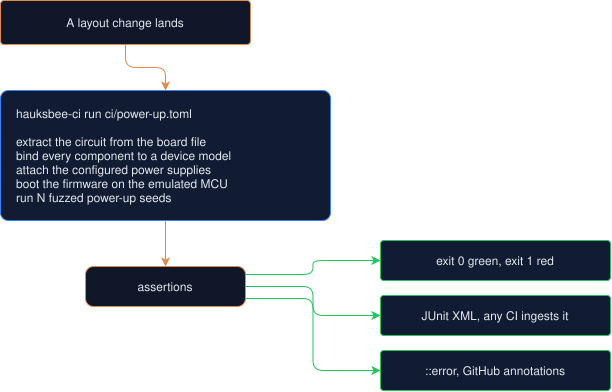

# CI for hardware

**On every layout change: boot the firmware on the emulated board, assert the
rail comes up above 4.9 V, assert the UART says hello, and assert the LED blinks.**

`hauksbee-ci` runs the hauksbee PCB emulator headless in
a pipeline. Point it at a board file and (optionally) a firmware ELF, and give
it a short list of assertions in a checked-in TOML file. It boots the firmware
on the board the layout actually implements. It then reports, with an exit
code, a JUnit report, and inline annotations, whether the board still does
what it is supposed to. The bug that cost weeks on the bench becomes a
one-line regression that fails on the broken layout forever.

This is not lint and it is not a DRC. It is the board, alive, under
assertions: the analog rails, the firmware's serial output, the blink
frequency, the stress ratings, all checked the way a test suite checks a
function.

**Where the web page fits.** `hauksbee serve`'s drop-a-board page is the quick
look: one board, one optional firmware image, one plain-language report. The
TOML spec on this page is the *repeatable* check: it pins down how the board
is powered, which firmware boots, and what must hold, so a pipeline can run it
on every commit. Assertions exist only in specs and run only through
`hauksbee-ci`. The browser never evaluates them. When a quick look turns into
something you want to keep true, `hauksbee-ci init <board>` turns the board
into a starter spec.

**Prerequisites.** A Rust toolchain if you build from source (`cargo build
--release -p hauksbee-ci`, or `scripts/install.sh` to put both binaries on
PATH), or grab the prebuilt release bundle and skip the build entirely.

## Contents

- [How a check runs](#how-a-check-runs)
- [Quick start](#quick-start)
- [Spec format](#spec-format): [top-level keys](#top-level),
  [assembly inputs](#assembly-inputs-bom-placement-variant),
  [`[[supply]]`](#power-supplies-supply), [`ramp_ms`](#cold-power-on-ramp_ms),
  [`[[net_drive]]`](#net-drives-net_drive),
  [`suppress_rail`](#rail-suppression-suppress_rail),
  [`[[override]]`](#component-overrides-override),
  [the as-built overlay](#the-as-built-overlay-asbuilt),
  [`[fuzz]`](#initial-state-fuzzing-fuzz),
  [tolerances + `[ensemble]`](#component-tolerances-tolerance--ensemble)
- [Assertions: `[[assert]]`](#assertions-assert), including
  [outcome search](#outcome-search-say-what-the-board-is-for) and
  [measurements](#asking-for-a-number-measurements)
- [Waiving a finding you have judged](#waiving-a-finding-you-have-judged)
- [Output](#output)
- [Boot coverage](#boot-coverage-watching-the-firmware-define-a-hi-z-control-net)
- [Schematic-stage CI](#schematic-stage-ci)
- [Wiring it into your repo](#wiring-it-into-your-repo):
  [the zero-config gate](#the-zero-config-gate-artifacts-without-a-spec)
- [Exit codes (the pipeline contract)](#exit-codes-the-pipeline-contract)
- [Limitations](#limitations)

## How a check runs



One spec describes one headless co-simulation and the things that must hold for
the build to pass. Check it into the hardware repo next to the board. Wire it
into GitHub Actions (`integrations/github-action`) or run it from KiCad
(`integrations/kicad-plugin`) or call the binary from any CI.

## Quick start

Rather than hand-write a spec from a blank page, scaffold one from your board,
`init` detects the supplies, MCU, and nets and emits a starter spec you edit:

```bash
hauksbee-ci init my_board.kicad_pcb   # writes my_board.toml into the CURRENT directory
# edit the scaffolded spec's [[assert]] blocks, then:
hauksbee-ci run my_board.toml
```

`init` writes into the directory you are standing in (so `cd ci &&
hauksbee-ci init ../hardware/my_board.kicad_pcb` lands the spec in `ci/`,
where the pre-commit hook and the GitHub action look), or wherever `--out
<dir-or-file.toml>` says. The generated `board = "..."` path is written
relative to where the spec lands, so it is valid on arrival.

Or run the bundled examples straight away. Every command on this page assumes
`hauksbee-ci` is on PATH (`scripts/install.sh` puts it there, or use the
release bundle); from a bare source checkout, substitute
`./target/release/hauksbee-ci` after `cargo build --release -p hauksbee-ci`.

```bash
# Boot the demo firmware on a small board and check rail + UART + blink.
hauksbee-ci run crates/hauksbee-ci/examples/blinky.toml

```

### Custom parts: the model library and `--models-dir`

`hauksbee-ci run` and `hauksbee-ci check` bind the board against the same layered model library as
`hauksbee run`: the builtin db, then installed packs, then the user model dirs
(`~/.hauksbee/models`, `~/.config/hauksbee/models`), then the spec's
`models_dir` key (resolved against the spec file) or, when given,
`--models-dir DIR` in its place (highest priority). The flag replaces the key
rather than adding to it, as `$HAUKSBEE_MCU_DIR` replaces `[mcu]
descriptor_dir`: the operator's setting wins. A directory that does not exist
is an error, whichever of the two named it. A custom `[[models]]` entry, including a
`kind = "mcu"` routing entry that maps a part value to a `renode:<part>` /
`qemu:<part>` backend and its SoC descriptor, therefore binds in CI exactly
as it does interactively:

```bash
hauksbee-ci run ci/board.toml --models-dir hardware/models
hauksbee-ci check ci/board.toml --models-dir hardware/models
# or, once, in ci/board.toml:  models_dir = "../hardware/models"
```

`--spice-models FILE` (repeatable, `hauksbee-ci run` only) loads a vendor's
own `.model` / `.subckt` cards above every model directory, the same flag
`hauksbee run` has; see [MODELS.md](../models/MODELS.md#a-vendor-spice-model-file).

MCU SoC descriptors themselves resolve from `$HAUKSBEE_MCU_DIR` /
`~/.config/hauksbee/mcu` before the built-ins, in CI and interactive runs
alike (see `docs/extending/add-an-mcu-variant.md` for the full two-file
recipe). `hauksbee-ci init`'s scaffold uses the same layered library, so the
detected MCU matches what a run would bind. Note: the spec's top-level `mcu`
key does NOT select the MCU. It is an informational note only. The board's
part value plus the routing entries decide.

## Spec format

A spec is TOML, designed to be pleasant to hand-write. Unknown keys, unknown
nets, and unknown component references are loud errors, and a misspelled net
name lists its near-matches ("did you mean `VDD_A`?").

### Top level

Every key the loader accepts, in one place. Unknown keys are rejected.

| Key             | Type     | Default       | Meaning                                                       |
| --------------- | -------- | ------------- | ------------------------------------------------------------- |
| `name`          | string   | `"hauksbee-ci"`| Label shown in reports.                                       |
| `board`         | path     | required      | Board file: `.kicad_sch` (schematic), `.kicad_pcb`, `.net`, Eagle `.brd`, IPC-D-356, Altium `.PcbDoc`, a gerber folder/zip. The same formats `hauksbee run` accepts. |
| `bom`           | path     | none          | BOM read and fail-closed reconciled before binding through the same production reader as `hauksbee run --bom`. See [assembly inputs](#assembly-inputs-bom-placement-variant). |
| `bom_columns`   | [string] | `[]`          | Explicit `role=Header` mappings for an ambiguous BOM, equivalent to repeatable `--bom-column`; requires `bom`. |
| `placement`     | path     | none          | Pick-and-place file reconciled against layout identity, package, position, side and rotation before binding. |
| `models_dir`    | path     | none          | Highest-priority model-library directory, resolved relative to the spec; used by `hauksbee-ci run`/`check` and the browser Checks path. A missing directory is an error; `--models-dir` replaces it. |
| `variant`       | path     | none          | Assembly-variant TOML with `name`, `fit` and/or `no_fit`; exact bytes and population decisions are separate evidence. |
| `firmware`      | path     | none          | Firmware to boot on the detected MCU: a compiled ELF/hex, a PlatformIO project directory, or a zip of either (same three input tiers as `run --firmware`, see [`../cosim/MCU.md`](../cosim/MCU.md)). |
| `mcu`           | string   | none          | Informational note only, nothing reads it. The MCU comes from the BOARD's part value via `[[models]] kind = "mcu"` routing entries (builtin, user model dirs, `--models-dir`); this field cannot force a backend. Distinct from the `mcu` field inside a `uart` `[[assert]]`, which IS load-bearing (it selects which MCU's UART the assertion reads). |
| `duration_ms`   | float    | `100`         | Simulated time to run; at most 600000 (ten minutes of board time), and at most 1,000,000 frames at `frame_ms`. |
| `frame_ms`      | float    | `1`           | Sampling cadence (how often nets are read).                   |
| `[timing]`      | table    | none          | Strict timing contract: `min_pulse_us` and/or `max_edge_error_us`. Poll backends adapt their real chunk or the run is INVALID; every report states measured coverage. |
| `ambient_c`     | float    | `25`          | Ambient temperature (C) for the steady-state junction-temperature estimate `max_temp` checks against; finite, above -273.15 and at most 500. |
| `asbuilt`       | path     | none          | `.asbuilt.toml` overlay: the physical rework delta (cut traces, jumpers, lifted pins, fitted values) applied to the bound board before every run. See [the as-built overlay](#the-as-built-overlay-asbuilt). |
| `fit`           | [string] | `[]`          | DNP part references to simulate as fitted regardless of `dnp`. Unknown references are loud errors. See [DNP.md](../ingest/DNP.md). |
| `no_fit`        | [string] | `[]`          | DNP part references to leave open regardless of `dnp`. See [DNP.md](../ingest/DNP.md). |
| `dnp`           | string   | `"honour"` | Policy for DNP parts neither list names: `honour` (leave them out), `fit-except-links`, or `fit-all`. See [DNP.md](../ingest/DNP.md). |
| `suppress_rail` | [string] | `[]`          | Nets whose auto-rail is removed (fed only through the board). |
| `[[supply]]`    | blocks   | none          | Power-supply legs (ideal / bench / wall / usb / battery). See [below](#power-supplies-supply). |
| `[[net_drive]]` | blocks   | none          | Nets forced to a fixed voltage for the whole run. See [below](#net-drives-net_drive). |
| `[[override]]`  | blocks   | none          | Component value swaps applied before binding. See [below](#component-overrides-override). |
| `[[tolerance]]` | blocks   | none          | Component-tolerance rules sampled per ensemble seed. See [below](#component-tolerances-tolerance--ensemble). |
| `[ensemble]`    | table    | none          | Tolerance-ensemble execution config (seed count, monte-carlo vs corners). |
| `[fuzz]`        | table    | none          | Initial-state fuzzing (random power-up levels on named nets). See [below](#initial-state-fuzzing-fuzz). |
| `[[scenario]]`  | blocks   | none          | Transient load scenarios that `rail_window` / `protection_trip` judge over. See [TRANSIENTS.md](../checks/TRANSIENTS.md). |
| `[[profile]]`   | blocks   | none          | Spec-local load-profile definitions a `[[scenario]]` can reference, in addition to the built-in profile database. See [TRANSIENTS.md](../checks/TRANSIENTS.md). |
| `[decoupling]`  | table    | none          | Opt-in capacitor parasitics (ESR/ESL) for the run. See [TRANSIENTS.md](../checks/TRANSIENTS.md). |
| `[ac]`          | table    | none          | Small-signal AC sweep that drives `phase_margin` / `ac_gain`. See [AC_ANALYSIS.md](../analysis/AC_ANALYSIS.md#ci). |
| `[[peripheral]]`| blocks   | none          | Buttons, pots, encoders, stimuli, bus slaves, VCD sinks attached for the run. See [PERIPHERALS.md](../cosim/PERIPHERALS.md). |
| `[[sensor]]`    | blocks   | none          | Declarative I2C/SPI register-map sensors attached for the run. See [PERIPHERALS.md](../cosim/PERIPHERALS.md). |
| `[[assert]]`    | blocks   | at least one  | The assertions, all of which must pass. See [Assertions](#assertions-assert). |

Paths are resolved relative to the spec file's directory.

### Assembly inputs: `bom`, `placement`, `variant`

Use these when the layout alone does not identify the exact purchased part or
when one superset layout has several fitted assemblies:

```toml
board = "../hardware/board.kicad_pcb"
bom = "../hardware/bom.csv"
bom_columns = ["reference=Customer Reference"]
placement = "../hardware/positions.csv"
variant = "../hardware/prototype.variant.toml"
duration_ms = 1

[[assert]]
kind = "no_faults"
```

The BOM and placement readers content-detect their dialects and feed the same
binder identity reconciliation used by `hauksbee run --bom --placement`.
Ambiguous columns, duplicate or conflicting rows, poor board overlap, package
or position contradictions, and malformed artifacts refuse before assertions.
`hauksbee-ci check` executes this same preparation path, so editor validation
and the gate agree. If repository-local parts participate in identity, pass the
same `--models-dir` to both commands; the option exists on both surfaces.

The separate variant file is deliberately small:

```toml
name = "prototype without sensor"
fit = ["R7"]
no_fit = ["U4"]
```

Its decisions merge with top-level `fit` and `no_fit`. A contradiction,
unknown reference, or duplicate within either artifact refuses; identical
same-side decisions across the two artifacts deduplicate. BOM population fields
remain advice: they never become hidden executable policy. CI JSON inventories
the board, spec, BOM, placement and variant with exact SHA-256s and
contributions; assertion evidence cites those causal inputs, and
`--emit-manifest` captures all five transitive inputs. See
[`BOM.md`](../ingest/BOM.md) and [`DNP.md`](../ingest/DNP.md) for the authority
and reconciliation rules. A population that leaves every component open is
invalid rather than vacuously GREEN, and a simulated peripheral `ref` cannot
name a component the selected variant leaves open.

### Timing coverage (`[timing]`)

Use a timing contract when an assertion depends on a firmware edge or pulse
being represented, rather than merely on the final settled voltage:

```toml
[timing]
min_pulse_us = 20.0
max_edge_error_us = 4.0
```

The policy is derived from the live backend. simavr reports each GPIO callback
at its MCU cycle, so timestamp precision and the guaranteed pulse floor are one
clock period (`1 / frequency`). Renode and QEMU discover GPIO by polling after
`run_micros`; Hauksbee therefore shrinks their actual chunk to the tighter of
`min_pulse_us / 2` and `max_edge_error_us`. Two polls per requested pulse ensure
one poll lies inside it even when an edge lands on a boundary. The poll bridge
takes integer microseconds, so a request needing a chunk below 1 µs is refused
as unrepresentable instead of rounded into false precision. Chunk subdivision
uses a ceiling, so the slice actually executed never exceeds the negotiated
maximum when a frame is not an exact multiple of it.

A `toggle` assertion on a poll backend must declare `timing.min_pulse_us`.
Without a pulse width, polling cannot prove that a rise and fall did not both
occur between samples. Exact callback backends count the ordered edge log, so a
pulse that begins and ends inside one analog chunk still contributes both
toggles to the assertion and activity reports.

An unmet contract, a cycle-stamped pulse proven to have been missed by a
tick-evaluated sequential part, or a GPIO edge storm that exceeds the bounded
analog PWL replay budget makes every assertion `INVALID` and exits 3.
It cannot be waived into green. The terminal, JSON, JUnit, GitHub checks UI and
web checks panel all publish the actual per-MCU timestamp precision, guaranteed
pulse floor, chunk, stamp tier, and any explicit refusal. Without `[timing]`,
those measurements are still reported, but no additional pulse-width claim is
requested and external backends retain their performance-oriented coarse default.

### Power supplies: `[[supply]]`

The engine already models bench, wall, USB, battery, and ideal legs. Attach one
to a supply net to run the board under a realistic source.

```toml
[[supply]]
net = "+5V"
kind = "bench"            # ideal | bench | wall | usb | battery
volts = 5.0
current_limit_a = 1.0     # bench: CC foldback above this
```

Per kind (the first field of each is REQUIRED; the loader rejects a leg
without it rather than assuming a voltage that could fabricate faults):

- `bench` takes `volts` (required), `current_limit_a`.
- `wall` takes `volts` (required), `r_out_ohms`, `ripple_vpp`, `ripple_hz`.
- `usb` takes `usb = "5v0.5a" | "5v1.5a" | "5v3a"` (required).
- `battery` takes `chemistry = "liion" | "alkaline" | "nimh" | "lifepo4"`
  (required), `cells`, `capacity_mah`, `soc`, `r_internal_ohms`.
- `ideal` takes `volts` (required).

Any kind that names a `volts` also takes `ramp_ms`.

A supply feeding an unnamed net (a DC jack wired straight to a diode, say) can
name it by pin instead: `ref = "P1"` plus `pin = "2"` in place of `net`. The
pin is resolved against the board, so the same spec runs on a schematic and a
PCB that spell the unnamed net differently; a `ref` or `pin` the board lacks is
a load error.

Declare a supply where the board takes power: a connector, a battery terminal,
or a regulator's input. A net a part on the board already drives (a
regulator's or converter's output, or a net tied to one through a sense
resistor, ferrite or inductor) is refused, because an ideal source there would
fight the part and carry its load, so its input would read low or negative
current. The refusal names the net to use instead, follows a chain of
regulators up to the first undriven input, and gives the `ref` + `pin` form
for an input net KiCad left unnamed. A linear charger carded as a regulator
(TP4054/TP4056 class) drives its battery pin the same way, so feed such a
board from the charger's input rather than declaring the cell.

#### Cold power-on: `ramp_ms`

**By default a supply starts already settled.** The transient march begins at
the board's DC operating point, so every capacitor is pre-charged at `t = 0`
and *there is no power-on transient at all*: an RC reset delay, a soft-start,
an enable ramp and an inrush question all answer "0 ms" on the naive spec.

`ramp_ms` models the cold start. The rail is driven from 0 V and ramps linearly
to `volts` over that many milliseconds; because the operating point is seeded
from the ramp's own starting value rather than from the setpoint, the
capacitors really do start discharged.

The ramp is sampled once per frame, so keep `ramp_ms` comfortably above
`frame_ms`: the operating point is seeded at the level the ramp has reached
after one frame, which is `frame_ms / ramp_ms` of the rail. With
`frame_ms = 0.05` a 1 ms ramp seeds the board at 5 % of the rail; at the 1 ms
default frame the same ramp is indistinguishable from no ramp at all.

```toml
[[supply]]
net = "V33"
kind = "ideal"
volts = 3.3
ramp_ms = 0.5        # the external 3.3 V input rises over 0.5 ms
```

A ramped rail is driven directly rather than through a behavioural supply leg,
so `ramp_ms` and the droop/ripple parameters of `bench` / `wall` / `usb` /
`battery` do not compose: a leg that names `ramp_ms` is a stiff ramp.

When a run asks a start-up-timing question (a `pulse_width`, or any `after_ms`
above zero) on a board where nothing makes the run time-varying -- every supply
un-ramped and `ideal`, no `[[peripheral]]` timeline, no `[[scenario]]`, no
firmware -- each such result carries a note saying so and pointing at `ramp_ms`.
The note is deliberately narrow: a spec with a stimulus, a scenario, firmware,
a behavioural leg or a ramp never sees it.

### Net drives: `[[net_drive]]`

Force a net to a fixed voltage for the whole run: external stimulus, a strap, or
a register bit that the firmware does not set.

```toml
[[net_drive]]
net = "WSEL"
volts = 5.0
```

### Rail suppression: `suppress_rail`

By default hauksbee attaches an ideal rail to every recognised supply net. When a
rail is physically fed *through* a board component (a sense shunt, a ferrite, a
regulator you want to exercise), suppress its auto-rail so the droop or collapse
is visible:

```toml
suppress_rail = ["VDD_A"]
```

### Component overrides: `[[override]]`

Swap a component's value before binding. This is how a repair is expressed:
change the wrong part to the right one and re-run the same assertions.

```toml
[[override]]
ref = "R_SHUNT1"
value = "0.05"            # the documented milliohm sense shunt
```

### The as-built overlay: `asbuilt`

`[[override]]` swaps a component's *value string* before binding. Some boards
differ from their design files more radically: traces cut with a knife, pins
lifted, jumper wires soldered, parts replaced. That is the physical rework
record. That delta lives in a declarative `.asbuilt.toml` overlay, and a spec
can reference one. hauksbee applies it to the bound board before every run,
ahead of any harness attachment:

```toml
asbuilt = "board.asbuilt.toml"   # relative to the spec file, like `board`
```

The overlay is fail-loud: an entry that matches nothing (or a different number
of devices/terminals than it declares) aborts the run with a line-numbered
error and a did-you-mean suggestion. The engine CLI accepts the same overlay with `hauksbee run board --asbuilt board.asbuilt.toml`.

The board's own static check, which adds a failing `static_check:` row per
gating finding, judges the same reworked board. The overlay is applied to the
static board first, the way `hauksbee --asbuilt --check` applies it: fitted
values, jumpers and fitted parts directly, and each cut or lifted transistor
terminal traced through the part's pin roles to the pad it severs, which then
sits on its own net (named `asbuilt-cut-(REF-PadN)`). A finding the rework
removes is gone, one it does not touch stays, and one it creates is reported.
An entry the static board cannot carry (a switch trip point, `von`/`voff`) is
never dropped: every static row on a part or net it reworks reads
`NOT JUDGED on the as-built board` (exit 3, not a pass), and the run carries a
verdict condition naming the entry. The copper (DRC) checks still read the
design files. Plain `hauksbee check` (no spec) judges the board as designed.

### Initial-state fuzzing: `[fuzz]`

Real boards power up with undefined register and latch states. Fuzzing runs the
sim under several seeds, each strapping the listed nets to a random level. An
assertion passes only if it holds on **every** seed, which is exactly what
catches a bug that only one power-up state triggers.

```toml
[fuzz]
seeds = 16
nets = ["WSEL", "OE_N", "RCLK"]   # undefined power-up bits
levels = [0.0, 5.0]               # the two states each is strapped between
```

Seed 0 is always the all-low baseline. The rest are spread deterministically,
so a run is reproducible.

### Component tolerances: `[[tolerance]]` + `[ensemble]`

A board that only meets its assertions at *nominal* component values is a
latent defect: real parts are ±1% / ±5% / ±10%, and some fraction of assembled
units will land outside the window. Declare the tolerances and hauksbee-ci
replays the whole assertion set across an **ensemble** of sampled builds, on
every commit.

```toml
[[tolerance]]
ref = "R*"                 # a literal ref, or a pattern (* matches any run)
percent = 10.0             # ±10% of the component's value
distribution = "gaussian"  # optional; default "uniform"

[ensemble]
seeds = 24                 # Monte-Carlo member count (default 16)
mode = "monte-carlo"       # "monte-carlo" (default) | "corners"
```

Rules apply in order and the **last matching rule wins** per component, so a
broad `ref = "R*"` can be followed by a tighter `ref = "R7"`. The nominal is
the component's board value (after any `[[override]]`). An override can also
declare its own spread, and then the `value` becomes the nominal:

```toml
[[override]]
ref = "R_SHUNT1"
value = "0.05"
tolerance = 1.0            # the repaired shunt is a ±1% part
```

Distributions: `"uniform"` samples the full ±tolerance band (assumes nothing
about vendor binning, stresses the edges hardest, and is the default).
`"gaussian"` uses the standard EDA convention, sigma = tolerance/3 truncated
at the tolerance bound (a part outside its marked tolerance would have been
binned out at the factory).

**What a green ensemble means, and does not.** Monte-Carlo is *sampled
coverage*: "passed 24/24 sampled tolerance seeds" is statistical evidence over
the tolerance space, **never a worst-case proof**, and the report words it
exactly that way. An assertion passes only if it holds on **every** member.

**Corner mode** (`mode = "corners"`) is the deterministic complement: instead
of random samples it enumerates every all-min/all-max combination of the
toleranced components (2^n runs). For a response that is *monotonic* in each
component value (dividers, ladders, most DC bias networks) the true worst
case is a corner, so a green corner run bounds it. For non-monotonic responses
(filters peaking mid-band, matched pairs) the interior can be worse than any
corner.

That condition is not left as a caveat with nothing behind it. Alongside the corners, corner
mode runs a small stratified **Latin-hypercube sample of the interior**: 4
probes for one toleranced component, 6 for two, 8 from three up, so the check
is a bounded handful of extra runs and never a multiple of the corner set. An
interior probe that fails where every corner passed **fails the assertion**
and says so, because the corners demonstrably did not bound that response.

A clean probe set is evidence for the monotonicity the bound needs, not proof
of it, and the report words it that way. Two limits are stated rather than
glossed: the probes sample the interior, so a non-monotonicity between them is
still possible; and each member is judged against the assertion's own window,
so a probe worse than every corner still passes while it stays in band.
Interior probes are numbered on from the last corner, so `--seed k` isolates
one exactly like a corner; the report calls them `interior probe k`.

Full enumeration is capped at 10 toleranced components (2^10 = 1024 corner runs, plus the interior probes). Above 10
toleranced components, corner mode refuses and points at Monte-Carlo. Corner
mode does not compose with `[fuzz]` (the corner index enumerates min/max
combinations, not fuzz seeds). Monte-Carlo does compose with `[fuzz]`.

**Open variant and corner sets.** Every seed is also run once per member of
each part the board leaves open: an orderable-variant set (a regulator whose
suffix the BOM does not give) or an assumed-corner set (an LED the board names
only by class, bound to assumed forward-voltage corners). Up to 2^10 = 1024
members the product runs in full and the pass needs no qualifier. Past that
nothing is dropped quietly. Assumed-corner sets are ordered (weak to strong),
so they fall back to a linear cover: every part at the same corner together,
plus each part at each corner against all the others weak and then all strong
(`2 + 2n` runs per seed for `n` two-corner parts), then to the joint members
alone if even that does not fit, then to the stand-in. Orderable-variant sets
are unordered, so no subset stands for the rest and they keep their stand-in.
Whatever ran short is a `verdict_conditions` entry in `--json`, a `CONDITION`
line in the log, JUnit suite output and GitHub annotations, a board-scoped
qualified assumption on every assertion's evidence, and turns the verdict line
into `GREEN, conditionally`. The stand-in is the first member the card lists,
which for an LED is the high-Vf (least current) corner: it bounds an
under-drive claim and not an over-current one, so a stand-in-only pass never
reads as a stress pass.

**Reproducibility is doctrine.** Re-running a member reproduces it
byte-identically, which is what makes a red build investigable. Every
Monte-Carlo sampled value is a pure function of (seed, component reference,
rule): in Monte-Carlo mode seed 0 is the nominal baseline, the tolerance stream
is domain-separated from the net-fuzz stream (adding a tolerance never changes
which fuzz levels seed N straps), and when `[fuzz]` and `[ensemble]` are both
present one shared seed stream drives both (the member count is the larger of
the two `seeds`). Corner mode has no nominal member (member 0 is the all-min
corner), and its member indices, corners and interior probes alike, are
renumbered by adding a tolerance rule: an index names a point within one spec
revision, which is what `--seed` replay needs. A failure names the seed and
the exact sampled values:

```
[FAIL] VOUT stays in [2.4, 2.6] V across the tolerance ensemble
      seed 8: VOUT: min=2.695 V (>= 2.4 V), max=2.708 V > allowed 2.6 V <- FAILED HERE ... [R1=9.17k, R2=10.7k]; passed 19/24 seeds (failing: 8, 10, 16, 18, 19)
      why: VOUT rose to 2.708 V, 108 mV above your 2.6 V ceiling ...
```

(The violated bound carries the `<- FAILED HERE` marker with the observed
extreme; the passing lower bound is reported un-annotated beside it. Note the
lowest VOUT ever sat on seed 8, 2.695 V, is itself above the 2.6 V ceiling:
this divider is high across the board on that draw.)

Re-run that one build in isolation. It reproduces byte-identically:

```bash
hauksbee-ci run ci/divider.toml --seed 8
```

A runnable two-sided demo ships in the examples: the same 10k/10k divider
passes at nominal and fails across the ±10% ensemble
(`crates/hauksbee-ci/examples/tolerance_divider.toml`), and its corner variant
lands exactly on the hand-computable [2.25, 2.75] V envelope
(`tolerance_divider_corners.toml`). Both are pinned as integration tests
against that analytic envelope (`crates/hauksbee-ci/tests/tolerance.rs`).

### Assertions: `[[assert]]`

At least one is required (a check with no assertions passes vacuously, so the
loader rejects it). Each has a `kind` from a closed set of twenty-three. The field
reference for each kind is in the product, so it is not repeated here:

```bash
hauksbee-ci explain               # every kind, one line each
hauksbee-ci explain rail_window   # its required and optional fields, what else the
                                  # spec must declare, a TOML example that passes
                                  # `hauksbee-ci check`, and why it usually fails
hauksbee-ci explain --json        # the whole catalogue, as the app reads it
```

The web app's "Add a check" has a "More checks" list built from the same
catalogue; each entry inserts its example into the raw TOML. A misspelled
`kind` in a spec is refused with `see: hauksbee-ci explain`, and a failed
assertion's `why:` line falls back to the catalogue's "when it fails" sentence
when the check has no measured shortfall to report. A test pins the catalogue to the loader's kind
list and runs every example through the spec validator, so the catalogue cannot
drift from the code.

| `kind` | Checks that | Read more |
|---|---|---|
| `voltage` | a net stays within `min` / `max`, optionally only after `after_ms` | |
| `rail_window` | a rail survives a `[[scenario]]` load step: floor, brief dips, recovery, overvoltage spikes | [TRANSIENTS.md](../checks/TRANSIENTS.md) |
| `no_faults` | the stress monitor raised no over-current, over-voltage, over-power, reverse-bias or over-temperature fault | |
| `max_current` | a resistor's or diode's peak current stays under `amps` | |
| `max_temp` | a part's steady-state junction temperature stays under `celsius` | [THERMAL.md](../checks/THERMAL.md) |
| `uart` | firmware serial output contains a string or matches a regex | |
| `toggle` | a net toggles at `freq_hz`, or at least `min_toggles` times | |
| `pulse_width` | the first complete pulse on a net has a set width | |
| `reaches` | the firmware executes a named function (within `deadline_ms`), or is not parked in one at the end of the run | [Asserts from observations](#asserts-from-observations) |
| `bus` | the firmware talks to an I2C address (ACKed, at least `min_transactions` times) or sends an SPI frame containing given bytes | [Asserts from observations](#asserts-from-observations) |
| `resets` | the MCU resets at most `max_resets` times, optionally counting one `cause` | [Asserts from observations](#asserts-from-observations) |
| `uart_baud` | the serial port the firmware set up runs at the expected baud, within a tolerance | [Asserts from observations](#asserts-from-observations) |
| `boot_coverage` | the firmware drives a control net to a level within a deadline of reset | [Boot coverage](#boot-coverage-watching-the-firmware-define-a-hi-z-control-net) |
| `protection_trip` | a battery or e-fuse protection cutoff fired, or must not have | [TRANSIENTS.md](../checks/TRANSIENTS.md) |
| `peripheral` | an attached device's end-of-run state, by `id` and `field` | [PERIPHERALS.md](../cosim/PERIPHERALS.md) |
| `phase_margin`, `ac_gain` | small-signal loop margin and gain, from an `[ac]` sweep | [AC_ANALYSIS.md](../analysis/AC_ANALYSIS.md#ci) |
| `model_coverage` | enough of the board bound to a real device model | |
| `hwtrace` | the simulation agrees with a scope trace you captured | [add-a-hardware-trace.md](../extending/add-a-hardware-trace.md) |
| `logic_level`, `fires`, `increases`, `decreases` | an intended outcome holds across operating conditions | [Outcome search](#outcome-search-say-what-the-board-is-for) |

#### Asserts from observations

You rarely need to type a number you can see. Wherever a value has been
observed, it becomes an assertion in one step:

```bash
# Boot the firmware once and propose assertions from what it did (UART text,
# entry point, the rate of every net that toggled), commented out in the spec:
hauksbee-ci init my_board.kicad_pcb --firmware fw.hex --suggest-asserts
# Uncomment the lines you mean, or edit a number to say what you expect instead.

# Add one assertion to a spec in one line; the fields are checked before anything is written.
hauksbee-ci add my_board.toml toggle net=D13 freq_hz=5
# Leave the numbers out and take them from one nominal run, by the app's margins:
hauksbee-ci add my_board.toml toggle net=D13 --observe
hauksbee-ci add my_board.toml uart contains="hauksbee-demo v1" --dry-run
```

`--suggest-asserts` and `add` share the scaffold writer with the app: in the
Live Sim, "Assert this" on a scope trace or a printed serial line opens the
check with the observed value filled in and says where it came from, and
"Assert what I expected" leaves the number to you and says, before you add it,
whether it would fail on what was seen. A poll-backend run (Renode, QEMU) cannot
time a pulse shorter than its sampling chunk, so the scaffold declares
`[timing] min_pulse_us` from the run's own coverage; see
[Timing coverage](#timing-coverage-timing).

`bus`, `resets` and `uart_baud` judge the bench record of what the MCU did,
which the co-simulation backend reports per run. Until a run supplies that
record they are validated and accepted in a spec but report INVALID with
"needs bench data" rather than a verdict, so they never pass vacuously. A
`reaches` check without `not_parked_in` or `deadline_ms` judges the entry point
the run already reports. Each kind's field defaults come from the same
catalogue the app reads (`default_from`), so the CLI, the app and these docs
cannot disagree on a kind's name or fields. The prior art this follows is in
[ASSERT_FROM_OBSERVATION.md](ASSERT_FROM_OBSERVATION.md).

What `explain` does not say, per kind:

- **`voltage`**: a `min` checks the worst (lowest) the net dipped to in the
  window, a `max` the worst (highest) it rose to. On a net that firmware drives
  from a host-paced ESP32 core, `after_ms` is not judged and the level is read
  over the whole run instead; see
  [Backend reach](#backend-reach-stated-honestly).
- **`pulse_width`**: the threshold and interpolated crossing times are the ones
  the `toggle` frequency path uses, so a width and a rate read off the same net
  agree; the reported `+-` is that path's grid residual (one sample step at
  each end). If the window holds no complete pulse (no opening edge, or none
  closing it before the run ends) the check REFUSES and reports no width. A
  refusal never passes: lengthen `duration_ms` or move `after_ms`.
- **`uart`**: this `mcu` (which MCU's UART to read, by reference) is
  load-bearing, unlike the top-level `mcu` key, which is an informational note
  nothing reads. On a host-paced ESP32 core, text that never appeared is
  INVALID rather than a FAIL (the firmware may only be slow on this host), and
  text that did appear is a PASS that names the run window as not judged.
  simavr and Renode keep the hard verdict.
- **`toggle`**: a COUNT is trustworthy on every backend. A FREQUENCY rests on
  the backend's clock rate matching the part, which is measured on
  `simavr:atmega328p` and every Renode platform (the clock-truth gates: SysTick
  on the STM32/nRF parts, `mtime` on the FE310, stock pico-sdk timing on the
  RP2040). The ESP32 family is the exception: its virtual time is wall-paced and
  host-load dependent, the run says so as a timing coverage warning, and on a
  firmware-driven net a `freq_hz` band (or a count above one) is reported but
  not judged; only "it toggled at all" keeps a hard verdict.
  [LIMITATIONS.md](../about/LIMITATIONS.md) tells the full clock story. On a
  poll backend a `toggle` must declare `timing.min_pulse_us`.
- **`max_temp`**: `Tj = Tambient + P * theta_JA`, with the ambient set once per
  spec by the top-level `ambient_c` key (default 25 C). `celsius` may be omitted
  only when the part's model carries a real datasheet Tj(max); on a part bound
  to a generic fallback model that form is refused at load, because the
  per-package default ceiling sits above where the overpower monitor trips, so
  it could never fail. A `max_temp` whose target never dissipates measurably
  fails with "the guard was never evaluated" rather than passing vacuously.
- **`boot_coverage`**: also requires no stress fault during the boot window
  before the net is first driven. `boot-coverage` remains accepted as an alias;
  new specs and waivers should use `boot_coverage`.
- **`model_coverage`**: pins the coverage your board reaches, so a part that
  loses its model fails the build instead of simulating a hole. `min_critical`
  is the metric that matters (it counts active ICs: an unbound regulator
  changes the answer, an unbound 0402 resistor usually does not).
  `max_active_unresolved` counts unresolved parts whose pins touch a real node.
  At least one threshold is required; the loader rejects an assertion with none.
  A failure names the parts, because that list is the next action (real output
  against the bundled Watchy board):

  ```
  [FAIL] model_coverage
        active ICs bound 4/6 (66.7%), floor 100.0%; 8 unresolved on connected nets (limit 0): M1, L1, C9, U6, AE1, C7, R12, U1
  ```

  Each name is either a model you can write, which takes one TOML file and no
  recompile ([extending/](../extending/README.md)), or a part whose vendor keeps
  its model closed. The report tells the two apart by naming both.
- **`rail_window`**: the `[[scenario]]` it judges over is a complete block of
  its own: `part` (required, the component drawing the load) plus a load
  `profile`, built-in or defined inline as a `[[profile]]`. Profiles and the
  rest of the scenario fields are documented in
  [TRANSIENTS.md](../checks/TRANSIENTS.md).

#### Outcome search: say what the board is for

Two kinds state an intended OUTCOME instead of a voltage window, and a
`[search]` block names the operating conditions it must hold across. A
violated outcome is reported at its worst condition, with measured against
intended, the parts that set it ranked, and a solved repair value. A rail
held by `[[net_drive]]` or swept by the search is also the supply every part
on it is bound at, so a level read from a card at its supply (an analog
switch's control threshold) follows the rail at each grid point.

**`logic_level`**: `net` reaches a valid logic high (or `level = "low"`) at
every logic input it drives. You do not type the level: it is the highest VIH
(lowest VIL) that any part on the net declares on its card, read at that
part's own solved supply. With `min_width_ms`, the level must be HELD that
long without a break: high enough for long enough, as a pulse driving the
next stage's input needs. The measured value is the highest level the net
holds over any window of that width, and at least `min_toggles` (default 1)
separate pulses must hold the level for that width. An explicit `min` (high)
or `max` (low) replaces the level read from the cards, for an input with no
card or a threshold the cards do not state.

```toml
[[assert]]
kind = "logic_level"
net = "PULSE_OUT"
min_width_ms = 0.001    # VIH held for 1 us
min_toggles = 3         # in at least 3 separate pulses (default 1)
# min = 2.0             # optional: this level instead of the cards' VIH
```

**`fires`**: the comparator `ref` fires: its output rises through mid-swing
`min_toggles` times (default once). With `target`, its first decision must also
trip at that input level, within `tolerance` (a fraction, default 0.05). The
trip is read as the mean of +IN and -IN at the solver step where they cross.
With `reset_below`, +IN must also fall below that level (V) after every
firing: the highest point it bottoms at between one firing and the next is
held to it, so a reset that only partly discharges the input fails even when
the firing count looks healthy.

Both kinds read every accepted solver step of the nets they judge, so a
100 ns spike or the instant a comparator decides is seen, even though it falls
between the 100 µs chunk samples the other kinds use.

```toml
[search]
culprits = 3                    # optional; 0 skips the ranking reruns
[[search.sweep]]
net   = "VCC"
volts = [4.75, 5.0]             # force the net to each value
[[search.sweep]]
net  = "I_IN"
amps = [4.19e-6, 6e-6]          # or inject each current into it

[[assert]]
name   = "trips at 0.387 V"
kind   = "fires"
ref    = "U1"
target = 0.387
tolerance = 0.1

[[assert]]
name = "the gate reads a high"
kind = "logic_level"
net  = "X"
```

Every combination of the sweeps runs (at most 256), crossed with any
tolerance ensemble. When run under `[search]`, the members execute in
parallel on up to four cores. For each violated outcome, the worst member
reruns once per nearby part with that part nudged +10%. "Nearby" means two
hops from the judged nets, not through rails or ground. Parts are ranked by
how far each one moves the outcome. A switch whose threshold the outcome
follows is named as self-limiting: the pulse ends once the switch it drives
turns on. The strongest passive is then solved for the value that meets the
intent:

```text
[FAIL] trips at 0.387 V
      seed 1: U1 fires 1 time(s), first tripping at 0.773 V; intended 0.387 V +/- 0.039 V [at VCC=5V]
      why: U1 trips 0.386 V above the intended level (2.00x)
        culprit 1: R2 (150k): +10% moves it +64 mV
        culprit 2: R1 (820k): +10% moves it -60 mV
        fix: R2 150k -> 73.2k meets the intent (rerun: U1 fires 1 time(s), first tripping at 0.410 V; ...)
```

A board that meets its outcomes passes with nothing to read. The pinned
case is `crates/hauksbee-ci/tests/outcome_search.rs`.

**`increases` / `decreases`**: a RELATION between grid points rather than a
check of each one. A quantity must rise (fall) `along` one swept net: the
comparator `ref`'s firing rate (rising output edges per second of window),
or a `net`'s time-averaged level. Members that differ only in the `along`
value form a series, and each neighbouring pair is judged; a flat pair fails
too (the condition does not reach the quantity). A violation names the pair
and both values, the other conditions it was held at, and fails both
members. Relations are not culprit-ranked: a 10% nudge moves a value, not
the sign of a response, so an inverted one is a topology finding.

```toml
[[assert]]
name  = "a higher input code fires faster"
kind  = "increases"
ref   = "U1"                    # or net = "X" for its mean level
along = "V_SET"                 # a [[search.sweep]] net with 2+ values
after_ms = 0.05

# [FAIL] a higher input code fires faster
#       U1 is 12k Hz at V_SET=0V but 4k Hz at V_SET=2V; 2 of 2 neighbouring pair(s) violate [with I_IN=6uA]
```

#### Asking for a number: measurements

On the numeric kinds -- `voltage`, `toggle`, `max_current`, `pulse_width`,
`phase_margin`, `ac_gain` -- **every bound is optional**. An assertion with no
bound at all (`min`, `max`, `amps`, `freq_hz`, `min_toggles` all absent) is a
MEASUREMENT: it reports the value, with the same uncertainty and the same
evidence notes a judged assertion carries, and claims nothing.

```toml
[[assert]]
kind = "voltage"
net = "PU"
after_ms = 13.0      # just tell me what PU is at 13 ms
```

- Human report: the row is marked `[MEASURED]`, not `[PASS]`.
- JSON: the result carries `"measured": true` alongside `"passed": true`.
- JUnit: a non-failing `<testcase>` whose `<system-out>` opens `measured:`.
- Web: the row chip reads `MEASURED`.

A measurement cannot fail, so it never reddens a run. It also never greens one
by itself: **a run whose results are ALL measurements headlines `MEASURED -
n/n measurement(s) reported, nothing judged` and exits 0**, not `GREEN`. Mix a
real bound in and the run is judged on that bound as usual.

Refusals and evidence still apply. A measurement whose evidence is undermined
is reported as INVALID exactly like a bounded assertion, and a measurement the
run could not take (no samples, too few edges) refuses rather than reporting a
number it did not measure.

Beyond `[[assert]]`, a spec can also declare **`[[peripheral]]`** (attach an I2C/
SPI slave model, a VCD waveform sink, or an ADC feed to the co-sim),
**`[[sensor]]`** (a declarative register-map sensor defined inline), and
**`[[scenario]]`** (a transient load profile + optional decoupling ESR/ESL that
the `rail_window` / `protection_trip` assertions judge over). The field
reference for each block is in [PERIPHERALS.md](../cosim/PERIPHERALS.md) (peripheral /
sensor) and [TRANSIENTS.md](../checks/TRANSIENTS.md) (scenario). For a runnable
`[[sensor]]` example see `lm75_thermostat.toml` in
`crates/hauksbee-ci/examples/`. `[[peripheral]]` and `[[scenario]]` blocks are
exercised by `crates/hauksbee-ci/tests/peripherals.rs` and
`tests/spec_and_assertions.rs` (copy-paste-able TOML fixtures).

## Waiving a finding you have judged

One `hauksbee-waivers.toml` beside the board reaches every gate in the
pipeline: `hauksbee run --check --strict`, the single-check gates (`--drc`,
`--lint`, `--si` under `--strict`), and `hauksbee-ci run`. A board plus its
waiver file gives the same verdict whichever gate reads it, so a waiver is a
real staged-rollout mechanism: land the board, waive the one finding you have
judged (with a reason and an expiry), and the rest of the suite keeps gating.

A check that fires on your board and is wrong should be waived with a reason and
expiry while it is reviewed; removing the whole suite also removes its valid
coverage.

A waiver is the third option. Put `hauksbee-waivers.toml` beside the board:

```toml
[[waive]]
check = "si"                      # "si", "lint", "drc", or "ci"
kind = "controlled_impedance"     # the rule, as it appears in --json
nets = ["USB_DP", "USB_DM"]       # or refs = ["U3"]
reason = "measured 92 ohm on the fab's stackup; our stackup file is wrong"
until = "2026-12-31"

[[waive]]
check = "ci"                      # a hauksbee-ci assertion failure
kind = "voltage"                  # the assertion kind
nets = ["+5V"]                    # the net(s) the assertion judges
reason = "bench-verified; the model's supply ESR is pessimistic on this rail"
until = "2026-12-31"
```

For `check = "ci"`, `kind` is the assertion kind (`voltage`, `no_faults`,
`boot_coverage`, ...), `nets` matches the assertion's `net`/`supply_net`, and
`refs` matches its `ref`. A waived assertion failure stays on four surfaces:
`[WAIVED]` in the terminal report, a `<skipped>` testcase (with the reason) in
the JUnit file, a `::warning` annotation on GitHub (subject to the annotation
cap, which truncates with an overflow line), and the `waived` field under
`--json`. It just does not turn the exit code red. The web checks panel is the
gap: it has no waiver concept at all, so a waived failure renders there as a
plain FAIL and drives the panel headline red beside exit 0. Read the waiver
state off the terminal, JUnit, GitHub or JSON surface, not off the
panel. An INVALID result (exit 3) can never be waived: a waiver
overrules a finding, and an INVALID is the absence of one, so waiving it would
green an untrustworthy run.

`hauksbee run <board> --check` reads the same file. Findings an active waiver
covers come out of the gate and appear in their own section:

```
== Waived (2) ==
These findings fired and were overruled. They are not in the gate.
  drc/short: +5V to GND on B.Cu
      because: the pour bridges these on purpose (until 2026-12-31)
```

Four rules, all enforced rather than suggested:

- **`reason` is required.** Six months on, a waiver with no reason cannot be
  told apart from a bug.
- **`until` is required.** A waiver that never lapses is a disabled check
  wearing a different hat. On the date it expires the finding comes back, and
  the report names the lapsed waiver so the red is explainable.
- **`nets` or `refs` is required.** Without one, the waiver silences the rule
  across the whole board, which is turning the check off with extra steps. A
  second occurrence elsewhere still gates. Matching is AND, not OR: every net
  you list must appear in one finding's own net set for the waiver to cover
  it, so a waiver listing eight nets does not cover eight findings, it covers
  only a finding that touches all eight. To overrule several findings, write
  one `[[waive]]` block per finding.
- **Waived is not hidden.** A board carrying ten overruled findings must not
  look like a clean one. Active waivers that matched nothing are called out
  too, since either the finding is fixed or the waiver no longer describes what
  fires.

A waiver file that does not parse is a warning, not a failed run, and every
finding it would have covered gates. A typo must never quietly disable a check.

Clearance violations are not waivable: they do not gate on their own, so there
is nothing to excuse them from.

## Output

- **Human report** to stdout: each assertion `PASS`/`FAIL` with the measured
  value, then a `GREEN`/`RED` summary.
- **Exit code**: `0` if every assertion passed, `1` if any failed, `2` on a
  spec/board error, `3` when the run is invalid for analysis (see
  [Exit codes](#exit-codes-the-pipeline-contract)).
- **JUnit XML** with `--junit out.xml`: one `<testcase>` per assertion, so
  GitLab, Jenkins, GitHub, Buildkite, or anything else surfaces the results.
  A waived failure appears as a `<skipped>` testcase carrying the waiver
  reason. A multi-spec run writes ONE merged document, one `<testsuite>` per
  spec, with honest aggregate counts.
- **JSON** with `--json`: one typed run object containing the exact
  `inventory`, canonical `assumptions`, and one causal `evidence` map per
  result as well as the verdict fields. Numeric assertions carry their solver
  error budget; human, JUnit, and GitHub output summarize the same object. See
  [Numerical error budgets](../analysis/ERROR_BUDGETS.md) for units, unknowns,
  and refusal semantics. An evidence map whose derived status is `undermined` makes the
  assertion INVALID (exit 3), never green; a live waiver is a visible,
  assertion-scoped `waived` assumption. The checked-in contract is
  `crates/hauksbee-ci/schemas/hauksbee-ci-report.schema.json` and its drift
  test is `crates/hauksbee-ci/tests/ci_report_schema_drift.rs`.
- **GitHub annotations**: when `GITHUB_ACTIONS` is set, `::error` workflow
  commands are emitted for failing/INVALID assertions so they show inline in
  the Checks UI. GitHub truncates at 10 annotations per type per step, so the
  budget is spent on verdicts: passing assertions emit no per-assertion
  `::notice` (the log and JUnit carry them), per-assertion errors are capped
  at 8 plus an overflow line plus the rollup, and warnings (dead rails,
  waived failures, typed evidence assumptions, substitutions, coverage holes)
  are capped at 9 plus an overflow line. The same stable assumption id and
  constructor-composed wording appear in JSON, human, JUnit and GitHub output.
- **Several specs at once**: `hauksbee-ci run a.toml b.toml` (or a shell glob,
  `hauksbee-ci run ci/*.toml`) runs each spec in turn, prints a per-spec
  verdict summary at the end, merges everything into the one `--junit` file,
  and exits with the worst code of the set (severity order 3 > 2 > 1 > 0, so
  an untrustworthy run outranks a spec error, which outranks a red). One
  desynced spec does not stop the others from running. With `--json`, one
  JSON object is printed per spec, one per line.
- **Waveforms** with `--waveforms DIR` (opt-in; every other output is
  unchanged): the sampled series behind each assertion, so you can plot what
  happened rather than read only the window's min and max. Every net an
  assertion names is recorded at the frame cadence and written per seed under
  `DIR/<spec-stem>/`: `seed<N>/net_<net>.csv` holds the whole run and
  `seed<N>/a<index>_<net>.csv` the assertion's own window (a scoped
  `rail_window` uses its scenario window). Each file is `time_s,<net>` CSV, the
  shape `hauksbee run --probe-csv` writes, and `index.json` maps every file to
  its net, assertion, kind, scenario and `window_s`. The samples are the
  settled per-frame values; an intra-frame extreme folded into a window's
  min/max has no timestamp, so the reported min can sit below the lowest
  sample. A series longer than 20,000 points is min/max-bucket decimated, which
  keeps every bucket's extremes (`index.json` gives `samples` and `points`).
  Non-analog assertions (`uart`, `no_faults`, `peripheral`, AC) have no file.
- **`--json`**: one object per spec on stdout, NDJSON. The shape is published
  as a JSON Schema (`crates/hauksbee-ci/schemas/hauksbee-ci-report.schema.json`,
  generated from the types and drift-tested against them) and the field-by-field
  contract, including which keys are absent rather than null and what counts as
  an additive change, is [JSON_OUTPUT.md](JSON_OUTPUT.md).

For a machine-readable single-board result outside the assertion runner,
`hauksbee run <board> --json` emits a documented object with a top-level
`ok`/`verdict`/`serious_count` rollup, see [JSON_OUTPUT.md](../analysis/JSON_OUTPUT.md).

## Boot coverage: watching the firmware define a Hi-Z control net

Some faults cannot be adjudicated from the *netlist alone*. A control
net (a MOSFET gate, a level-translator enable, a display reset, a
chip-select) is driven only by an MCU GPIO that goes high-impedance at reset.
Its power-up default is therefore undefined. Whether that is a *bug* depends
on the intended default state of the controlled load, and the netlist does
not encode that: a display that must be on by default and a haptic motor that
must be off by default have byte-identical netlist topology. Two real such
faults (Watchy e-paper RES#, ZSWatch DISPLAY-EN) are recorded as honest
misses of the static checks for exactly this reason. A static check firing
there would be a confident false positive on a shipped board, on the very
same topology that is correct elsewhere.

The `boot_coverage` assertion makes the class decidable by running the
firmware. Instead of guessing the intended default, it **watches what the
firmware actually does**. It runs the co-sim from reset and requires the MCU
to drive the named control net to a defined level within a deadline, with no
stress fault during the boot window before the net is first driven (rails
hold while the input is still undefined).

### The two-sided demo

One constructed board, `crates/hauksbee-ci/examples/boards/boot_gate_clean.kicad_pcb`:
an ATmega328P whose PB0 drives a 2N7002 N-MOSFET gate, with **no pull resistor on
the gate net** - so at reset the gate floats (Hi-Z), exactly the undefined-default
shape. Two real AVR firmware variants (built with `avr-gcc`,
`testdata/firmware/boot_gate_{a,b}/`). It is the same parts as
`boards/boot_gate.kicad_pcb`, routed with no copper short: that sibling keeps its
two deliberate GND/+5V shorts as the DRC and waiver fixture, and a CI run cannot
go GREEN over a board whose own `hauksbee check` fails, so the demo needs the
clean one:

```bash
# variant A configures PB0 promptly and drives the gate HIGH -> PASS
hauksbee-ci run crates/hauksbee-ci/examples/boot_gate_pass.toml
#   [PASS] GATE_CTRL driven to >= 3 V within 20 ms of reset
#          control net 'GATE_CTRL' driven to >= 3 V at 1.00 ms (<= 20 ms), boot window clean

# variant B never touches PB0; the gate floats the whole run -> FAIL
hauksbee-ci run crates/hauksbee-ci/examples/boot_gate_fail.toml
#   [FAIL] GATE_CTRL driven to >= 3 V within 20 ms of reset
#          control net 'GATE_CTRL' was never driven to >= 3 V (firmware left it
#          Hi-Z / undefined through the whole run); observed range [0 V, 0 V]
```

The check has teeth only because variant B goes RED: the same board, the
same assertion, two firmwares, opposite verdicts. This is pinned as an
integration test, `crates/hauksbee-ci/tests/boot_coverage.rs`.

### Backend reach (stated honestly)

This proof uses the **AVR (simavr)** backend, one of hauksbee's **three**
co-sim backends. The mechanism is backend-agnostic and runs on all three.
Besides AVR, the **Renode** backend co-sims supported STM32, **nRF52840**, and
SiFive RISC-V, and the **QEMU** backend co-sims ESP32 / ESP32-S3 / ESP32-C3 (see
`docs/cosim/MCU.md` for the full matrix). The nRF52840 fixture boots with:
`hauksbee run` boots the bundled
`testdata/firmware/renode_demos/nrf52840-zephyr_shell.kicad_pcb` +
`nrf52840-zephyr_shell.elf` pair to the Zephyr `uart:~$` prompt through
Renode.

Watchy uses an ESP32 QEMU path. ZSWatch uses nRF5340, for which Hauksbee does
not currently ship a Renode platform. A `boot_coverage` assertion requires a
supported backend plus firmware built for that exact target; the bundled
two-sided proof is AVR.

Honest per-backend caveat for boot_coverage: GPIO-drive detection reads the
port's output register once per co-sim chunk. On AVR (cycle-accurate simavr)
and Renode (STM32/nRF52840 ODR poll) that read is direct. The ESP32 QEMU model
does not expose GPIO output read-back, so the firmware must mirror its output
word to the RAM mailbox the backend reads (the bundled ESP32 demo does).
Edges faster than the chunk alias on the poll bridge either way, so match the
firmware switching rate to the chunk size (see `docs/cosim/MCU.md`
limitations).

Deadlines on a host-paced clock are not verdicts. The ESP32 QEMU backend runs
without icount and credits simulated time from host wall-clock spans, so how
much firmware runs in a simulated millisecond depends on the host: the Watchy
v1.5 RES drive has measured 384-496 ms on one machine and 704-760 ms on
another, either side of its 700 ms deadline. On such a core `boot_coverage`
judges only whether the firmware drove the net to its level at all. A drive
that never happens is still a hard FAIL. A drive that happens is a PASS whose
detail gives the time as approximate and says the deadline was "not judged",
and whose evidence carries a reduced-fidelity assumption, so it reads
`evidence: qualified` on the terminal, JUnit, annotations, JSON and the web
view. The unjudged bound is also a condition of the run's verdict: a
`verdict_conditions` entry in `--json` and a `CONDITION` line naming the
assertion and the bound, and the verdict line reads `GREEN, conditionally`.
The same holds for the other firmware-time bounds on a firmware-driven
net: a `toggle` `freq_hz` band or a `min_toggles` count above one, `pulse_width`
`min`/`max`, and a `logic_level` `min_width_ms` or pulse count above one. simavr
counts cycles and Renode advances virtual time per instruction, so their timing
verdicts stay hard.

The assertions that read what the firmware produced in the run's window follow
the same rule, because how much firmware fits in a simulated window moves with
the host:

- A `uart` or `peripheral` (`bytes`, or a `field` range) assertion whose content
  is there is a PASS on that content. Its detail names the run window as "not
  judged" and its evidence is `qualified`, since a slower host might not have got
  that far.
- The same assertion whose content is NOT there is **INVALID** (exit 3), not a
  FAIL and not a PASS: the firmware may simply not have run that far in this
  host's window, so its silence is not evidence against it. The detail starts
  `INVALID: host-paced clock:`, quotes what was printed, and says to raise
  `duration_ms` or judge the claim on simavr, Renode or hardware. No miss is
  promoted back to a FAIL on a host-paced clock, because a run reports nothing
  that proves the firmware had run to completion (a parked program counter is
  also where an idle RTOS core sits).
- A failure no host speed changes stays a hard FAIL: a `peripheral` whose bus was
  never exercised, an unknown peripheral id or field, and a `boot_coverage` net
  the firmware never drives. A `uart` assertion that names an `mcu` which is not
  host-paced keeps its hard verdict whatever else on the board is.

A level asserted inside a simulated-time window on a firmware-driven net (a
`voltage` with `after_ms`, a `rail_window` with a `scenario`) follows the same
rule. "Firmware-driven" means an MCU pin net the firmware drove during the run,
the same evidence the `toggle` and `pulse_width` rules use (a pin a
peripheral block drives counts once the core has used that block: a UART
transmit pin after it sent bytes, the I2C clock and data lines and the SPI
clock and data-out lines after the backend delivered bus events, and, on a
QEMU ESP32 whose emulator reports the GPIO matrix, a pad a PWM, timer or RMT
output is routed to), or a net
downstream of one: a net the firmware moves through the board without driving
it (a MOSFET or load-switch output, a regulator's rail through an enable pin
the firmware drives, a logic stage's output, an output a bus peripheral sets when
the firmware writes it, such as a DAC's output and what an op-amp buffers from
it, named after the bus net the firmware drove), whose not-judged bound names the
driven net it follows, for these rules and the timing rules above alike. A 0 V
current-sense source in series with a feed is a wire to this walk. A rail an
independent source holds is not downstream of a pull-up beside it, and the
MCU's own supply is not downstream of the current its pins draw. Where the
window starts in the firmware's progress depends on the host, so the window is
"not judged" and the `min`/`max` level is read over every sample of the run:

- A level that holds over the whole run is a PASS. Its detail reads
  `EN over the whole 200 ms run: ...` and names the window as not judged, and
  the pass is conditional, as above.
- A level that holds only inside the window (the window leaves out an earlier
  excursion) or does not hold inside it is **INVALID** (exit 3), with the
  `INVALID: host-paced clock:` detail. On a real chip the window may start
  before or after the firmware brings the net into range, so neither verdict
  would be honest. Assert the level over the whole run, assert the drive with
  `boot_coverage` (its deadline is disclosed, not judged), or judge it on
  simavr, Renode or hardware.
- A `rail_window`'s dip, spike, recovery and settling budgets on such a net are
  firmware-paced times and are not judged. One with only those budgets and no
  `min`/`max` level has nothing left to judge and is INVALID. One with no
  `scenario` reads its level over the whole run anyway, so its level verdict
  stays hard.
- A net the firmware never drove keeps its hard verdict, as does a net nothing
  the firmware drives can move (an always-on regulator output, a divider off a
  held rail): the solver's own time base is exact, so `after_ms` skips a rail's
  ramp exactly as on any backend.
- A pad whose peripheral output the backend cannot see counts too. On a
  host-paced core whose backend cannot observe peripheral routing, every
  output-capable MCU pad with no drive evidence that is wired to anything, and
  every net downstream of one, may carry a PWM, timer, RMT or unmodelled-bus
  waveform. A windowed level there is read over the whole run: a whole-run
  pass is a conditional PASS naming the pad, and a pass only inside the window
  is INVALID (never a FAIL), naming the pad and why the backend could not see
  its routing. No QEMU build sees an IO_MUX direct function (a pad's own SPI,
  UART, SD or EMAC signal), so every QEMU ESP32 pad qualifies; a build without
  the GPIO-matrix patch is also blind to PWM, timer and RMT outputs, and the
  reason gives `scripts/install-sims.sh --qemu-patched-source` as its remedy.
  Input-only pads (`[[soc.input_only]]`, ESP32 GPIO34-39), unwired pads, and
  pads QEMU itself attaches to the flash bus are left out. A pad the matrix
  shows routed is firmware-driven as above, and its stale `GPIO_OUT` bit is not
  read as its level.

```text
[PASS] RES driven to >= 2.6 V within 700 ms of reset
      control net 'RES' driven to >= 2.6 V at ~440 ms (approximate); the 700 ms
      boot deadline and the hold through it not judged: MCU U1 runs on a
      host-paced clock, ...
      evidence: qualified
```

## Schematic-stage CI

**Catch it before you even lay out the board.** Point a spec's `board` at a
`.kicad_sch` and hauksbee-ci runs the same headless co-simulation against the
schematic, with no PCB in existence yet. hauksbee derives the netlist
geometrically from the schematic, the way eeschema derives it (wires, pins,
junctions, labels, power symbols, hierarchy). See `docs/ingest/SCHEMATICS.md`.
Everything else in this document, supplies, drives, fuzzing, every assertion
kind, works unchanged.

Schematic-level faults include a brownout, a missing pull-up, a power pin on the
wrong net, or an interaction between a wrong value and a floating strap. These
are decidable from the schematic before a layout exists.

```toml
# A schematic-stage spec: board is a .kicad_sch hierarchy root.
name = "power-up sanity (schematic)"
board = "hardware/myboard.kicad_sch"
duration_ms = 1

[[supply]]
net = "VCC"
kind = "ideal"
volts = 5.0

[[assert]]
kind = "voltage"
net = "VCC"
min = 4.99
max = 5.01

[[assert]]
kind = "no_faults"
```

A runnable example against KiCad's own `pic_programmer` demo (a 2-sheet
hierarchy) ships at `crates/hauksbee-ci/examples/pic_programmer_schematic.toml`:

```bash
hauksbee-ci run crates/hauksbee-ci/examples/pic_programmer_schematic.toml
```

It exits 0 (GREEN). It judges only the input side of the board, the rail ahead
of the 7805 and the input diode, because four parts of `pic_programmer` have no
model (the LT1373 boost converter on VCC, a 24Cxx EEPROM socket and two PIC
sockets). Asserting VCC itself, or `no_faults`, on this board is INVALID
(exit 3) until those are modelled; `--json` lists them under `assumptions`.

### Load the hierarchy root, not a sub-sheet

hauksbee loads a `.kicad_sch` board **by path** so its sheet hierarchy
resolves: sub-sheets live in sibling files, and only the path-based loader
follows them. Point the spec at the **hierarchy root**. If you point it at a
sub-sheet (a file referenced by another `.kicad_sch` in the same or parent
directory), hauksbee-ci stops with a clear error naming the root, rather than
silently extracting one page and running a partial board:

```
invalid spec: board pic_sockets.kicad_sch is a sub-sheet of
pic_programmer.kicad_sch. Point the spec at the hierarchy root
(pic_programmer.kicad_sch) so the whole design is loaded, not one page of it
```

### The agreement guarantee

For a project that has *both* a schematic and a layout, the same spec run at
either stage returns the same verdict. Tests validate that the schematic
netlist and the PCB netlist induce the identical partition of pins into nets
(see hauksbee-extract's cross-validation tests), so a `voltage` / `no_faults`
/ blink check passes on the `.kicad_sch` exactly when it passes on the
`.kicad_pcb`.

That property matters: the schematic-stage check is not a weaker
approximation you re-do later. It is the *same* check, available earlier. An
integration test enforces this
(`crates/hauksbee-ci/tests/schematic_ci.rs`): it runs the `pic_programmer`
spec against both the schematic and the layout, and the per-assertion results
must agree.

### Editor integration: the honest state

KiCad's PCB editor (pcbnew) has an action-plugin API, and hauksbee-ci ships a
plugin for it (`integrations/kicad-plugin`). The **schematic editor (eeschema)
has no hauksbee plugin integration**. Use the pre-commit hook or the CLI for
schematic-stage checks; the project PCB plugin can discover specs whose board
is a schematic.

So drive schematic-stage CI the way it is actually natural to drive it:

- **Pre-commit hook** (recommended): `integrations/pre-commit` runs the matching
  spec whenever a staged `.kicad_sch` (or `.kicad_pcb`) changes and blocks the
  commit if it goes RED. The commit, not the editor, is the right gate for a
  schematic-level fault, and this is the most natural schematic-stage
  integration anyway.
- **CLI**: `hauksbee-ci run myboard-schematic.toml` from a Makefile, a watch
  script, or by hand.
- **From pcbnew, on the project**: the pcbnew plugin discovers every spec next to
  the board (and in a sibling `ci/`), including specs whose `board` is the
  project's `.kicad_sch`, so you can run a schematic-stage check from the PCB
  editor on the same project.

The shared core (`hauksbee_ci_core.py`) is file-type-agnostic; it handles the
spec path and the binary performs the check.

## Wiring it into your repo

The two wirings most repos want, hauksbee-ci installs itself. Neither needs you
to copy a file out of this repository, and both are idempotent, so running them
twice is not a mistake:

```bash
hauksbee-ci hook install          # the pre-commit gate
hauksbee-ci github-action --write  # .github/workflows/hauksbee.yml
```

`hook install` detects which mechanism the repo already uses: a repo with a
`.pre-commit-config.yaml` gets the hauksbee-ci entry added to that file (then run
`pre-commit install` as usual), and any other git repo gets a plain,
self-contained `.git/hooks/pre-commit`. An existing hook is preserved rather than
replaced. `github-action` prints the workflow to stdout so you can read it before
committing to it; `--write` lands it at `.github/workflows/hauksbee.yml`, or at a
path you pass, and refuses to overwrite a file that has diverged from what it
would write. `hauksbee-ci init` ends by offering both.

A run tells you which of the two is still missing. A GREEN run closes with
`next: gate commits locally too: hauksbee-ci hook install` until the hook is
there, and goes quiet once the hook and the workflow both exist. A RED run puts a
`why:` line under each failed assertion naming the usual cause, and
`hauksbee-ci explain <kind>` has that kind's fields and a working example.

What `github-action` writes is deliberately small but production-safe: it takes
the auto-detect path for a repo with one spec or one board, filters out changes
unrelated to hardware/firmware/models, and cancels a superseded run on the same
branch. The copy-it-yourself workflow below spells out the optional inputs when
you need a matrix or an explicit spec.

- **Pre-commit (schematic or layout)**: the `repos:` entry lives in
  `integrations/pre-commit/.pre-commit-config.yaml` if you would rather paste it
  yourself. Hardware checks then run before a commit lands. See
  `integrations/pre-commit/README.md`.
- **GitHub Actions**: `integrations/github-action/example-workflow.yml`
  is the annotated, path-filtered version. The action runs in two modes: `mode: spec` (a
  `spec:` or `specs:` input naming one or more hauksbee-ci TOML files, globs
  included, merged into one JUnit report) and `mode: check` (a `board:`
  input, gated with `hauksbee run <board> --check --strict`, no spec needed).
  With neither given it auto-detects: exactly one Hauksbee spec in `ci/` or the
  repository root runs as spec mode; with no spec, exactly one supported board
  file runs as check mode. Ambiguity fails rather than falling through to a
  different gate. It publishes the JUnit results to the Checks tab. See
  `integrations/github-action/README.md`.
- **KiCad (pcbnew)**: install the pcbnew action plugin from
  `integrations/kicad-plugin` to run a spec on the open board and see the
  verdict in a dialog. eeschema has no plugin API yet (see above). Use the
  pre-commit hook or CLI for schematic-stage checks.
- **Any CI**: call `hauksbee-ci run spec.toml --junit results.xml` (or
  `ci/*.toml` for the whole set) and consume the exit code and the JUnit
  file. Ready-made GitLab CI, Jenkins, Azure DevOps, and Buildkite blocks are
  in [RECIPES.md](RECIPES.md).

### The zero-config gate: artifacts without a spec

The spec path above is the one that asserts behaviour, and it is worth writing.
But a board with no spec yet can still gate, and still publish artifacts your CI
knows how to render, from the static suite alone:

```bash
hauksbee run my_board.kicad_pcb --check --strict \
  --junit hauksbee.xml --sarif hauksbee.sarif
```

`--junit <file>` and `--sarif <file>` are flags on `hauksbee run`, not just on
`hauksbee-ci`. They write the selected `run` surface, with waivers already
applied: `--drc` contains DRC, `--lint` contains lint, `--check` contains the
whole static suite, and `--headless` contains the co-sim findings. Waivers are
applied before finalization, so a waived finding is absent rather than
present-and-ignored.

- **JUnit** gives one `<testsuite>` per check and one `<testcase>` per finding,
  with the findings that fail the gate as `<failure>` elements. A check that
  found nothing carries a single passing `no findings` testcase, so a green suite
  is visible in the report rather than missing from it.
- **SARIF** is 2.1.0, so GitHub code scanning and anything else that speaks SARIF
  will annotate the pull request. Gating findings come through as `error` and
  non-gating ones as `warning`, each rule id being `check/kind` (`drc/short`,
  `si/crystal_load_cap`). The location is the board file; SARIF has no notion of
  a millimetre, so the coordinates stay in the message text.

Both grade on the finding's own `gating` flag, which the `--json` findings carry
too, and NOT on the severity word. The gates are wider than the `serious`
severity below. The `invalid` route keeps its own shapes: a whole-run refusal is
a JUnit `<error>` and a SARIF `hauksbee/invalid-for-analysis` result, never a
`<failure>`. The routes that go through an evidence finding instead (unbound
verdict-critical parts, undermined run-level coverage) are a `<failure>` like
any other gate-grade finding, so what tells those apart is the text
(`INVALID evidence: …`) and the `evidence/undermined` rule id, not the element.

The selected JSON verdict, process exit, JUnit, SARIF and GitHub annotations all
answer the same question. Requested paths receive a fail-closed pending document
before board or firmware parsing and are committed once at the terminal outcome;
CLI usage errors replace them before exiting too. Red builds remain archiveable
without allowing a pre-analysis error, refusal, abrupt exit or interruption to
leave a previous green file at the same path. Pair gate-grade findings with
`--strict` when the process exit itself must gate the job. The GitHub Action's
`mode: check` is this path pre-wired.

Path identity is checked before that first write. A JUnit/SARIF path that is the
same underlying file as a board, BOM, firmware, other run input/output, or the
other CI artifact is refused even when the alias is a hard link. Unsafe paths
are never modified; choose distinct files and rerun.

## Exit codes (the pipeline contract)

Two commands gate, with two deliberately different contracts (also printed at
the end of each binary's `--help`):

| exit | `hauksbee-ci run` / `check` | `hauksbee run` / `check` |
|---|---|---|
| 0 | every assertion held (or every failure is waived); check: every spec valid | clean, or report-only without `--strict` |
| 1 | an assertion failed (RED) | input error: a board or input could not be read |
| 2 | spec/board error, usage error, unwritable output; check: any diagnostic | findings under `--strict`, or a usage error |
| 3 | invalid for analysis | invalid for analysis |

- A closed stdout (`... | head`) ends either binary quietly with exit 141
  (128 + SIGPIPE) and no panic message. `hauksbee check <board>` is shorthand
  for `hauksbee run --check <board>`.
- `hauksbee-ci run` has no `--strict`, deliberately: a board used outside its
  datasheet, or an unmodelled part that can move the very net under assertion,
  must not need a flag before the exit code says so. A multi-spec invocation
  exits with the worst code of the set, severity 3 > 2 > 1 > 0.
  [RECIPES.md](RECIPES.md) maps exit 3 to "unstable" rather than a plain red in
  GitLab, Jenkins, Azure DevOps and Buildkite.
- A waived failure exits 0 while its own result still reports `passed: false`;
  [JSON_OUTPUT.md](JSON_OUTPUT.md) says how to read the three verdict fields
  together. An INVALID result (exit 3) can never be waived.
- `hauksbee run` static reports (`--lint`, `--drc`, `--si`, `--usb-c`,
  `--check`, bare `--json`) are **report commands: they exit 0 even when they
  print a serious finding**, unless you pass `--strict` (alias
  `--fail-on-findings`). Gating a pipeline on `hauksbee run` without `--strict`
  gates on nothing; the CLI says so on stderr when it prints a gate-grade
  finding without it. `--strict` gates on `--drc` true copper shorts,
  `--lint` high/medium findings, `--si` any real finding, `--usb-c` a serious CC
  verdict, and `--check` / bare `--json` the union of these.
- Keep exit 1 and exit 2 apart in a pipeline: 1 means your input was never
  analysed, 2 usually means it was analysed and the board is at fault. Usage
  errors (an unknown option, two report flags at once, a board file with no
  subcommand) also exit 2 and analyse nothing, so a step that treats 1 and 2
  alike will report a broken file path as a broken board.
- The `verdict` in `--json` and the exit code agree wherever the gate is armed
  (`fail` is 2, `invalid` is 3, `pass` is 0). The few places they deliberately
  part company, and what `invalid` means on the model-dependent surfaces, are
  in [JSON_OUTPUT.md](../analysis/JSON_OUTPUT.md#top-level-verdict).
  `--thermal` gates on coverage by default; see [THERMAL.md](../checks/THERMAL.md).

### What makes an assertion INVALID (exit 3)

For `hauksbee-ci run`, exit 3 means the result cannot be trusted: the analog
solve aborted, an assertion's evaluation window overlapped a failed solve span,
an assertion's evidence is `undermined`, or a host-paced clock (ESP32 QEMU)
cannot judge the claim (firmware content absent at the end of the run, or a
level that holds only inside its window, `INVALID: host-paced clock:`). It does
not require the whole solve to have failed: one assertion whose window
overlapped one failed chunk is enough, because its answer rests on voltages
nobody solved.

`undermined` is not a flag anyone opts into; it is derived from the assumptions
on an assertion's own causal path:

| on the asserted net | evidence | verdict |
|---|---|---|
| an unmodelled (open) ACTIVE part the run proved can drive it (the `co-sim COVERAGE HOLE` wording) | `undermined` | INVALID, exit 3 |
| an unmodelled part the circuit shows cannot drive it (the net's DC level is defined through modeled elements) | `qualified` | PASS, exit 0, with the caveat stated |
| a datasheet operating requirement this run MEASURED as violated (`operating_limit_violated`: a minimum load current, supply envelope, rail order, input range, or source-impedance limit) | `undermined` | INVALID, exit 3 |
| a documented omission of the model itself (`reduced_fidelity`: "temperature is not modelled", one channel of eight) | `qualified` | PASS, exit 0, with the caveat stated |
| firmware with no evidence it executed, or executed under a fault handler, a held reset or an out-of-range supply (`not_exercised` on `firmware/<ref>`; see `execution` in the JSON and the `EXECUTION EVIDENCE` note, documented in [MCU.md](../cosim/MCU.md#execution-evidence)) | `undermined` | INVALID, exit 3 |

An assertion's causal path is its subject: the asserted net(s), or every net a
named `ref` touches other than ground (every part shares ground, so reaching
through it would put each open part on the board on the path) plus that part's
supply chain. The chain walks upstream from each of the part's rails through
the regulators and converters feeding it, the switches and pass FETs it is a
switched branch of, and the series conductors (inductors, ferrites, fuses,
sense resistors) joining it, to where the board takes power. On the path are
every part loading a rail of that chain (they set the current through it, which
decides the result when the source limits current or has impedance), every
other pin of a part passing or regulating power along it (an enable, a gate, so
whatever controls the chain), and a part powered from a chain rail through a
filter (a resistor or ferrite to its `power_in` pin). Loads behind a second
regulator on the chain are not. So a junction-temperature claim on a linear
regulator fed through a load switch is undermined by an open switch controller
or an open motor driver on the bench-supplied rail upstream. A `uart`
assertion's subject is the MCU it reads (its
`mcu`, or every MCU that printed when none is named), so an unmodelled part on
any of that MCU's pins, rails, reset or clock, or on the chain powering it,
undermines it, and an unmodelled part elsewhere on the board does not.
Assertions with no subject at all (`no_faults`, model coverage) take the whole
board.

## Limitations

- The MCU co-sim runs on three backends, each co-simming its own cores (no
  silent fall-back to AVR): **AVR** (shipped pin-map recipes target
  ATmega328P), **Renode** (supported STM32, nRF52840, SiFive RISC-V), and
  **QEMU** (ESP32/-S3/-C3). Renode and
  QEMU are external emulators located at run time. If the emulator is not
  installed, instantiation fails with a clear install message rather than
  degrading to a different core. `hauksbee doctor --backends` reports which
  backends this build can actually locate. GPIO edges are sampled once per
  co-sim chunk, so signals faster than the chunk alias (see
  `docs/cosim/MCU.md`).
- `max_current` peak tracking covers resistors and diodes directly. The
  `no_faults` stress monitor covers other component kinds instead of a
  numeric ceiling.
- Fuzzing perturbs the named nets' initial logic levels (the undefined
  power-up bits). It does not yet randomize internal MCU RAM.
- Tolerance-ensemble members run serially. Each member is an independent
  bind+solve, so a parallel runner is a natural follow-up, but the co-sim
  backend's thread-safety is unproven and a racy runner would be worse than a
  slow one.
- Tolerance sampling lives in the CI spec layer. Deck-level `{mc(nominal,
  tol)}` / `{gauss(nominal, tol, sigma)}` parameter functions for
  `hauksbee sim` SPICE decks are a planned follow-up, not yet implemented.
- Schematic-stage CI loads the hierarchy root and recurses its sub-sheets.
  The "you pointed at a sub-sheet" guard is best-effort: it detects a
  sub-sheet referenced from the same or parent directory (the layouts real
  projects use). A hierarchy nested more than one directory deep can slip
  past the guard. The fix is the same either way: point the spec at the root
  `.kicad_sch`.
- Bus membership in schematics is not yet modelled, so a design that carries
  nets over buses extracts those nets split into their members (it never
  over-connects). Cross-validated corpus projects without buses match their
  layout net-for-net. See `docs/ingest/SCHEMATICS.md`.
